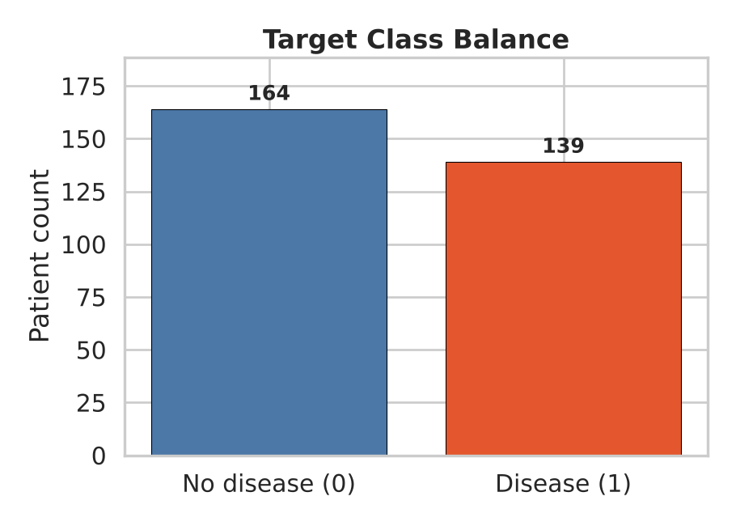
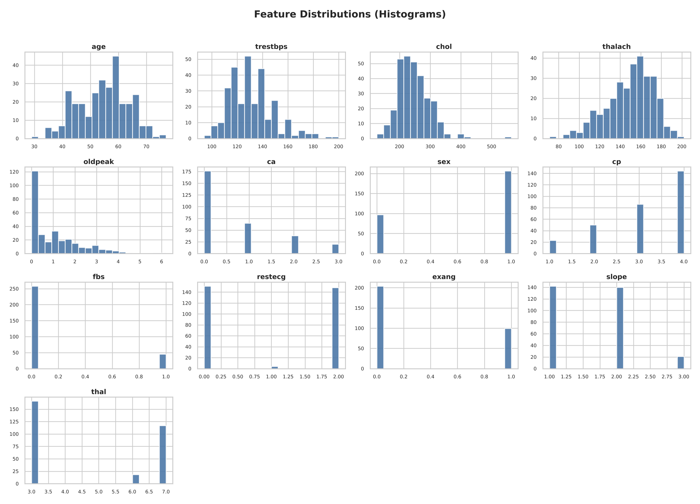
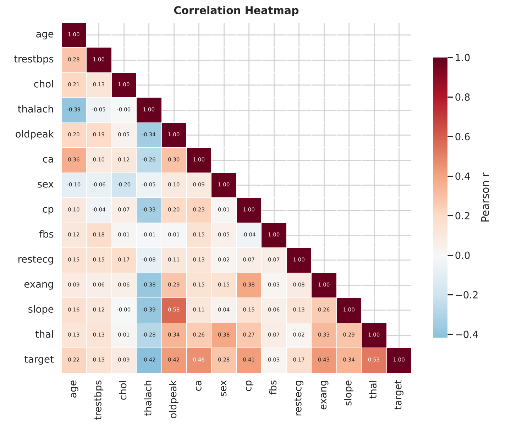
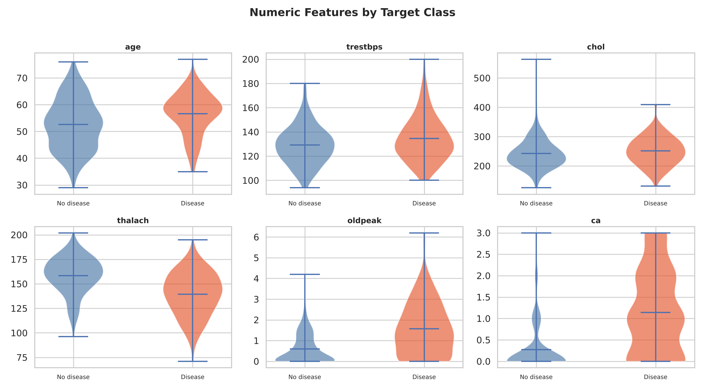
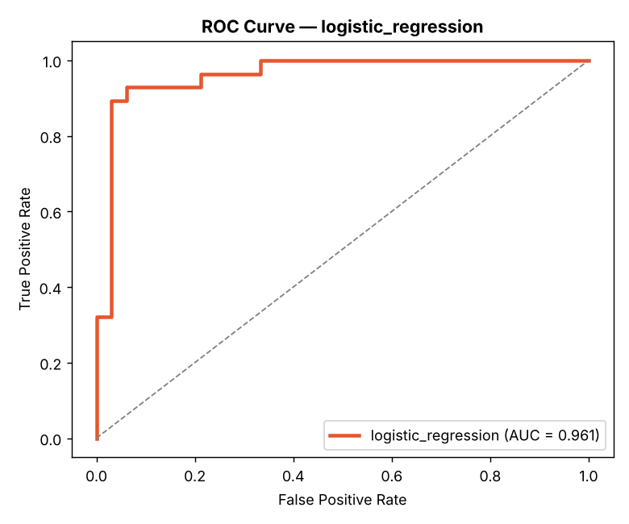
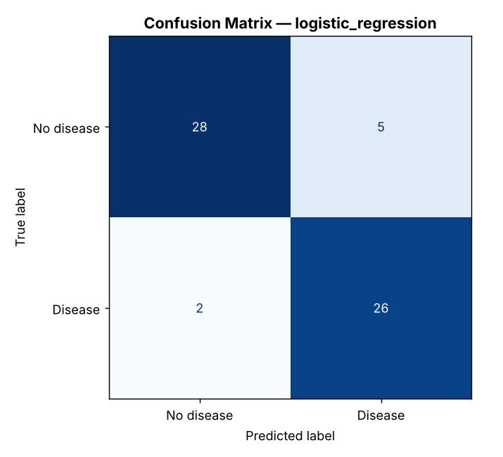
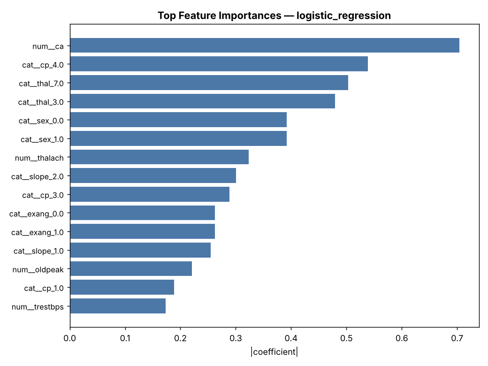
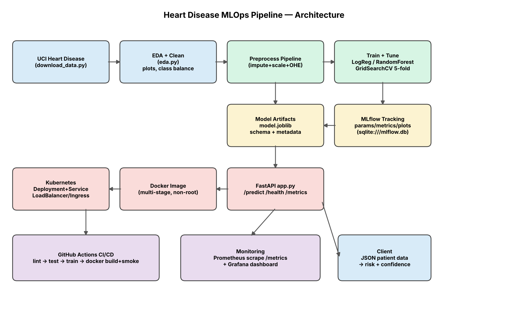

# 1. Introduction & Objective

This report describes a complete, reproducible machine-learning system that predicts the presence of heart disease from routine clinical measurements and serves the model as a monitored, containerised API. The classifier is one component of a larger production system: data acquisition, exploratory analysis, leak-free preprocessing, experiment tracking, automated tests, CI/CD, Docker, Kubernetes manifests and monitoring are all part of the deliverable and are wired together so that the whole pipeline runs from a clean checkout using one requirements file.

Two principles guided the design. **Reproducibility**: fixed seeds, a pinned requirements file, and a data script that reads a bundled copy of the original UCI file. **Train/serve parity**: preprocessing and model live in a single scikit-learn `Pipeline`, so an API request is transformed exactly like a training row.

**Code repository:** <https://github.com/veerusgithub/heart-mlops>

# 2. Dataset & Data Acquisition

## 2.1 Source and lineage

The data is the **UCI Heart Disease** dataset, Cleveland Clinic subset: file `processed.cleveland.data` from the UCI Machine Learning Repository (Detrano et al., 1989). The file has **no header row**, 14 columns, and writes missing values as `?`. `src/download_data.py` therefore:

1. reads the bundled file `heart+disease/processed.cleveland.data` (or downloads it from the UCI URL if it is absent);
2. assigns the 14 column names, hard-coded in the order given by UCI's `heart-disease.names` (pandas matches names by position, so the order was verified against that documentation and against the first data row);
3. converts `?` to `NaN`;
4. binarises the raw label `num` (0–4, angiographic disease status) as **target = 1 if num > 0, else 0**, following the UCI note that experiments distinguish presence (1–4) from absence (0);
5. writes `data/heart_raw.csv` and prints row count, missing values, class balance and a SHA-256 digest.

There is deliberately **no third-party fallback**: an early draft of this project used a community CSV mirror, and its label coding turned out to be the reverse of UCI's. Reading only the original file removes that class of silent error. Only the Cleveland subset is used because it is the one used in the published experiments; the Hungarian, Swiss and VA files have far more missing values and come from different hospitals.

## 2.2 Features

All values below are the **raw UCI encodings**, which differ from some derived copies of the dataset.

| Feature | Meaning | Coding | Treated as |
|---|---|---|---|
| age | Age in years | 29–77 | numeric |
| sex | Sex | 0 = female, 1 = male | categorical |
| cp | Chest-pain type | 1 typical angina, 2 atypical, 3 non-anginal, 4 asymptomatic | categorical |
| trestbps | Resting blood pressure (mm Hg) | 94–200 | numeric |
| chol | Serum cholesterol (mg/dl) | 126–564 | numeric |
| fbs | Fasting blood sugar > 120 mg/dl | 0 / 1 | categorical |
| restecg | Resting ECG | 0 normal, 1 ST-T abnormality, 2 LV hypertrophy | categorical |
| thalach | Maximum heart rate achieved | 71–202 | numeric |
| exang | Exercise-induced angina | 0 / 1 | categorical |
| oldpeak | ST depression induced by exercise | 0–6.2 | numeric |
| slope | Slope of peak exercise ST segment | 1 up, 2 flat, 3 down | categorical |
| ca | Major vessels coloured by fluoroscopy | 0–3 | numeric (ordinal count) |
| thal | Thallium scan result | 3 normal, 6 fixed defect, 7 reversible defect | categorical |
| **target** | Heart disease present | 0 = no, 1 = yes | label |

`thal` is coded 3/6/7, which are labels rather than quantities, so it is one-hot encoded; scaling it as a number would invent distances between the codes.

## 2.3 Cleaning

- **Duplicates:** none in this file (303 unique rows).
- **Missing values:** 6 cells in 6 rows — `ca` (4) and `thal` (2). Rows are **kept**; imputation happens inside the model pipeline (Section 4), so it is fitted on training folds only.
- **Types:** all feature columns coerced to numeric.
- The cleaned dataset is written to `data/heart_clean.csv`.

# 3. Exploratory Data Analysis

`src/eda.py` produces four figures in `reports/figures/` and a summary in `reports/eda_summary.json`.

## 3.1 Class balance

| Class | Count | Share |
|---|--:|--:|
| No disease (0) | 164 | 54.1% |
| Disease (1) | 139 | 45.9% |

The classes are nearly balanced. A model that always predicts "no disease" would score only 54% accuracy, so accuracy is meaningful here — but because a missed patient is costlier than a false alarm, ROC-AUC and recall are reported alongside it.

{ width=55% }

## 3.2 Feature distributions

{ width=92% }

Cholesterol (`chol`, maximum 564) and ST depression (`oldpeak`, many zeros, maximum 6.2) are right-skewed; blood pressure and heart rate span wide ranges on different scales. This motivates standard scaling for the linear model and keeps outliers in (they are clinically possible values, and the logistic model is regularised).

## 3.3 Correlations

{ width=78% }

Pearson correlation with the target, ranked by absolute value: `thal` 0.53, `ca` 0.46, `exang` 0.43, `oldpeak` 0.42, `thalach` −0.42, `cp` 0.41, `slope` 0.34, `sex` 0.28. Weak: `age` 0.22, `restecg` 0.17, `trestbps` 0.15, `chol` 0.09, `fbs` 0.03.

Pearson r on integer-coded categories (`thal`, `cp`, `slope`) is only indicative, because their codes have no numeric order, so group rates tell the clearer story:

- **thal:** disease in 22% of patients with normal results (37 of 166), but 76% with a reversible defect (89 of 117) and 67% with a fixed defect (12 of 18).
- **cp:** disease in 73% of patients with *asymptomatic* chest pain (type 4) against 18–30% for the three angina/pain types. This is counter-intuitive but a known property of this dataset: patients referred for angiography without symptoms are often referred because of other findings.
- **sex:** 55% of men have disease against 26% of women.
- **Numeric means (healthy vs disease):** `thalach` 158 vs 139 bpm, `oldpeak` 0.6 vs 1.6, `age` 52.6 vs 56.6 years.

The largest correlation between two predictors is 0.58 (`slope`–`oldpeak`), so multicollinearity is moderate and all 13 features are kept.

## 3.4 Class separation

{ width=88% }

The violin plots show clear shifts for `thalach` (lower in disease), `oldpeak` and `ca` (higher in disease), while `chol` and `trestbps` overlap heavily, which agrees with their weak correlations.

# 4. Feature Engineering & Preprocessing

All transforms are in `src/preprocessing.py`, assembled as one `ColumnTransformer`:

- **Numeric** (`age, trestbps, chol, thalach, oldpeak, ca`): median imputation → `StandardScaler`.
- **Categorical** (`sex, cp, fbs, restecg, exang, slope, thal`): most-frequent imputation → `OneHotEncoder(handle_unknown="ignore")`.

One-hot encoding expands the 13 raw features into **25 model inputs** (6 numeric + 19 category indicators). `handle_unknown="ignore"` keeps serving robust to unseen codes, while the API's Pydantic schema independently rejects impossible codes (for example `thal=5`) with HTTP 422. The transformer is the first step of the model pipeline, so it is **re-fitted inside every cross-validation fold** — no information from validation data leaks into imputation or scaling.

# 5. Model Development, Tuning & Evaluation

## 5.1 Method

Two classifiers were built in `src/train.py`: **Logistic Regression** (interpretable linear baseline) and **Random Forest** (non-linear, captures interactions). Both use `class_weight="balanced"` and sit in a `Pipeline(preprocessor → classifier)`. Each is tuned with **5-fold stratified `GridSearchCV` scored on ROC-AUC**. The data is split 80/20 with stratification and `random_state=42`: **242 training / 61 hold-out** rows. The hold-out set is never used for tuning *or* for choosing between models.

| Model | Grid | Selected |
|---|---|---|
| Logistic Regression | C in {0.01, 0.1, 1, 10}; solver in {lbfgs, liblinear} | C = 0.1, lbfgs |
| Random Forest | n_estimators in {200, 400}; max_depth in {None, 5, 10}; min_samples_leaf in {1, 2, 4}; max_features in {sqrt, log2} | 200 trees, depth None, leaf 2, log2 |

## 5.2 Results

**5-fold cross-validation on the training split (mean):**

| Model | ROC-AUC | Accuracy | Precision | Recall | F1 |
|---|--:|--:|--:|--:|--:|
| **Logistic Regression** | **0.911 ± 0.018** | 0.843 | 0.852 | 0.801 | 0.823 |
| Random Forest | 0.903 ± 0.031 | 0.806 | 0.795 | 0.783 | 0.785 |

**Hold-out set (61 patients: 33 healthy, 28 with disease):**

| Model | ROC-AUC | Accuracy | Precision | Recall | F1 |
|---|--:|--:|--:|--:|--:|
| **Logistic Regression** | **0.961** | 0.885 | 0.839 | 0.929 | 0.881 |
| Random Forest | 0.954 | 0.885 | 0.818 | 0.964 | 0.885 |

## 5.3 Model selection

**Logistic Regression was selected**, because it has the higher cross-validated ROC-AUC (0.911 vs 0.903) with lower variance across folds, the same hold-out accuracy, and is simpler and easier to explain. Selection used cross-validation only, so the hold-out numbers remain an unbiased final estimate.

The two models are statistically close. With only 61 hold-out patients, the Random Forest's higher recall (0.964 vs 0.929) is a difference of **one patient** (27 vs 26 of 28 detected), and a bootstrap 95% interval for the selected model's hold-out ROC-AUC is roughly 0.90–1.00. The honest conclusion is "about 0.91 ROC-AUC in cross-validation and 0.96 on a small hold-out", not a precise ranking. Recall is the clinically important metric (a false negative misses a sick patient); the selected model's confusion matrix shows 26 of 28 diseased patients detected and 5 of 33 healthy patients flagged.

{ width=46% }
{ width=46% }

{ width=60% }

The strongest drivers are `ca` (more blocked vessels → higher risk), asymptomatic chest pain (`cp_4`), and a reversible thallium defect (`thal_7`), with a normal thallium result (`thal_3`) and higher `thalach` protective — consistent with the EDA and with clinical expectations.

# 6. Experiment Tracking (MLflow)

MLflow is integrated with a SQLite backend (`sqlite:///mlflow.db`). Each training run logs:

- **Parameters:** model name, CV folds, test size, seed and every tuned hyper-parameter.
- **Metrics:** best grid-search CV score, CV means and standard deviations for all five metrics, and the five hold-out metrics.
- **Artifacts:** ROC curve, confusion matrix and feature-importance plots.
- **Model:** the fitted pipeline (`mlflow.sklearn.log_model`).

`mlflow ui --backend-store-uri sqlite:///mlflow.db` shows the two runs side by side. Because the seed and data are fixed, re-running training reproduces identical metrics.

# 7. Model Packaging & Reproducibility

The selected pipeline is saved to `model_artifacts/`: `model.joblib` (complete fitted preprocessing + classifier), `feature_schema.json` (feature order and numeric/categorical split) and `metadata.json` (model name, parameters, selection metric, CV and hold-out ROC-AUC, seed, row count, and the scikit-learn/Python versions used, since a pickled model should be served with the same scikit-learn version that trained it).

Reproducibility rests on: a fixed `random_state`; version-bounded `requirements.txt` (plus a lean `requirements-serve.txt` for the container); preprocessing packaged inside the model object; a bundled copy of the source data with a download script that verifies counts; and repo-root-anchored paths, so every script runs from any working directory.

# 8. CI/CD Pipeline & Automated Testing

## 8.1 Tests

`tests/` holds **29 Pytest tests** in three modules:

- `test_preprocessing.py` (7): duplicate removal, `?` → NaN, feature-schema integrity, imputation, scaling, one-hot expansion.
- `test_data.py` (4): the column list matches UCI's documented order; the bundled file has 303 rows with 4 missing `ca` and 2 missing `thal`; the binarised target reproduces the published 164 / 139 split; code ranges match the raw UCI encodings.
- `test_api.py` (18): endpoints, prediction schema, batch prediction, validation (out-of-range, missing field, invalid UCI codes such as `cp=0`, `thal=2`, `ca=4`; acceptance of all valid `thal` codes) and a check that the shipped sample files are valid requests.

The "known cases" test uses two real patients and is a **smoke test** of the serving path, not a measure of accuracy — those patients were part of training. All 29 tests pass.

## 8.2 GitHub Actions

`.github/workflows/mlops-pipeline.yml` runs four fail-fast jobs: **lint** (flake8; syntax/undefined-name errors fail the build), **test** (install from `requirements.txt`, prepare data, train, run Pytest, upload JUnit and model artifacts), **train** (data → EDA → train, uploading model, plots, metrics and the MLflow database) and **docker-build** (build the image and smoke-test `/health` and `/predict` in the container). A failing step stops the pipeline with its log, and each run keeps its artifacts.

# 9. Containerisation (FastAPI + Docker)

The `Dockerfile` is multi-stage: a builder installs the serving dependencies into a virtualenv; the runtime stage (`python:3.11-slim`) copies the venv, `app.py`, `src/` (only `preprocessing.py` is imported at serving time) and `model_artifacts/`, runs as a **non-root** user and defines a `HEALTHCHECK` on `/health`. `app.py` sits at the repository root because it is the service entry point (`uvicorn app:app`), whereas `src/` holds the offline pipeline scripts (download, EDA, training) that are not run in the container.

| Endpoint | Method | Purpose |
|---|---|---|
| `/` | GET | Service metadata |
| `/health` | GET | Liveness/readiness (model loaded?) |
| `/metrics` | GET | Prometheus metrics |
| `/predict` | POST | One patient → prediction, confidence, P(disease) |
| `/predict/batch` | POST | Many patients → predictions |

Inputs are validated by Pydantic with the **raw UCI codes** (`cp` 1–4, `slope` 1–3, `ca` 0–3, `thal` in {3, 6, 7}); invalid input returns HTTP 422. Example (UCI row 2, a diseased patient):

```json
{"age":67,"sex":1,"cp":4,"trestbps":160,"chol":286,"fbs":0,"restecg":2,
 "thalach":108,"exang":1,"oldpeak":1.5,"slope":2,"ca":3,"thal":3}
→ {"prediction":1,"label":"Heart disease","confidence":0.9818,
   "probability_disease":0.9818,"model_name":"logistic_regression"}
```

```bash
docker build -t heart-api:latest .
docker run --rm -p 8000:8000 heart-api:latest
curl -X POST localhost:8000/predict -H "Content-Type: application/json" -d @samples/patient.json
```

The API was verified live under `uvicorn` with real HTTP requests (`screenshots/live_api_proof.txt`). Docker build/run proof is captured as screenshots on the author's machine (Section 13).

# 10. Production Deployment (Kubernetes)

`deployment/` contains manifests for Minikube or Docker Desktop (and any cloud cluster): `deployment.yaml` (2 replicas, resource requests/limits, liveness and readiness probes on `/health`, Prometheus annotations), `service.yaml` (LoadBalancer, port 80 → 8000), `ingress.yaml` (nginx rule) and `hpa.yaml` (2–5 replicas at 70% CPU).

```bash
eval $(minikube docker-env)        # PowerShell: minikube docker-env | Invoke-Expression
docker build -t heart-api:latest .
kubectl apply -f deployment/
kubectl get pods,svc
minikube service heart-api-service --url
```

# 11. Monitoring & Logging

**Logging.** Every prediction is logged to stdout as a structured JSON line (input, prediction, probability, latency in ms), which is container-friendly and ready for any log collector.

**Metrics.** `/metrics` exposes `heart_requests_total{endpoint,status}`, `heart_predictions_total{outcome}` and the latency histogram `heart_predict_latency_seconds`. `monitoring/docker-compose.monitoring.yml` starts the API with Prometheus (scraping `/metrics`) and Grafana with a provisioned dashboard showing request rate, prediction mix, latency percentiles and error rate.

```bash
docker compose -f monitoring/docker-compose.monitoring.yml up --build
# Grafana http://localhost:3000 (admin/admin) · Prometheus http://localhost:9090
```

# 12. Architecture

{ width=88% }

Data flows from the UCI file through EDA/cleaning and the preprocessing pipeline into tuned training, with MLflow recording each run and the best pipeline saved as a model artifact. The artifact is served by FastAPI, packaged in Docker, deployed on Kubernetes and observed by Prometheus/Grafana; GitHub Actions gates the whole chain.

# 13. Setup, Reproduction & Evidence

```bash
git clone <repo-url> && cd heart-mlops
python -m venv .venv && source .venv/bin/activate     # Windows: .venv\Scripts\Activate.ps1
pip install -r requirements.txt
python src/download_data.py && python src/eda.py && python src/train.py
python -m pytest tests/ -v
uvicorn app:app --port 8000                           # docs at /docs
```

**Deployed API:** local Kubernetes (Minikube / Docker Desktop); access with `minikube service heart-api-service --url`, or run the container as in Section 9.

**Evidence** (images stored in `screenshots/`):

| # | Evidence | File |
|---|---|---|
| 1 | Training run output | `01_training_run.png` |
| 2 | MLflow run comparison | `02_mlflow_ui.png` |
| 3 | Pytest — all passing | `03_pytest.png` |
| 4 | GitHub Actions — green run | `04_github_actions.png` |
| 5 | Docker build | `05_docker_build.png` |
| 6 | Container serving `/predict` | `06_docker_run_curl.png` |
| 7 | Swagger UI | `07_swagger_docs.png` |
| 8 | `kubectl get pods,svc` | `08_k8s_pods.png` |
| 9 | Service URL test | `09_k8s_service_url.png` |
| 10 | Grafana dashboard | `10_grafana.png` |
| 11 | Prometheus targets | `11_prometheus_targets.png` |

# 14. Limitations & Future Work

- The Cleveland subset is small (303 patients), so the 61-patient hold-out gives wide uncertainty; repeated cross-validation or adding the other three UCI sites (with site-shift analysis) would tighten estimates.
- Only two model families were tuned; gradient boosting and probability calibration are natural next steps.
- Monitoring covers operational metrics; data-drift and prediction-drift detection (for example Evidently) would complete the MLOps loop.
- This is an academic demonstrator, **not a medical device**, and must not inform clinical decisions.

# 15. Conclusion

The project delivers a reproducible pipeline from the original UCI Cleveland file to a monitored, containerised API: verified data acquisition, leak-free preprocessing, two tuned and tracked models, a cross-validation-selected Logistic Regression (CV ROC-AUC 0.911; hold-out ROC-AUC 0.961, recall 0.929), a validated FastAPI service with logging and Prometheus metrics, a multi-stage Docker image, Kubernetes manifests, a fail-fast GitHub Actions pipeline and a Grafana dashboard — backed by 29 passing tests.

**References.** Detrano, R. et al. (1989). International application of a new probability algorithm for the diagnosis of coronary artery disease. *American Journal of Cardiology*, 64, 304–310. UCI Machine Learning Repository, Heart Disease dataset.
